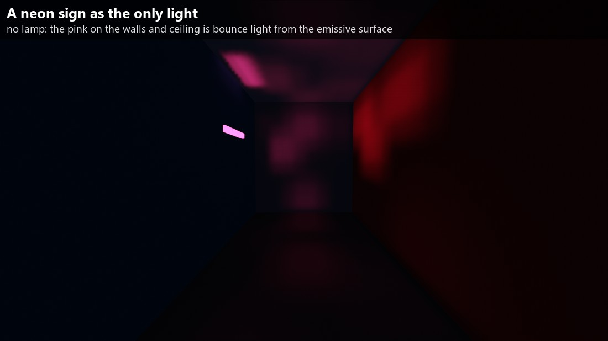
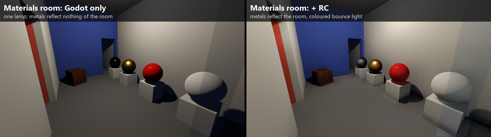
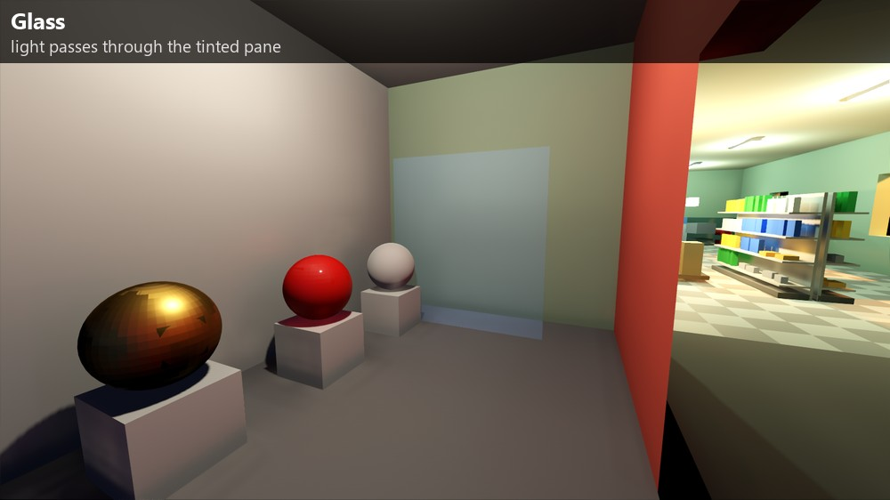
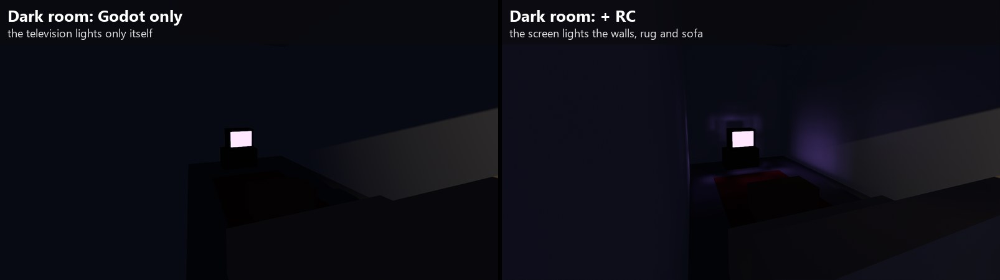
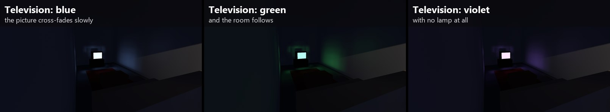
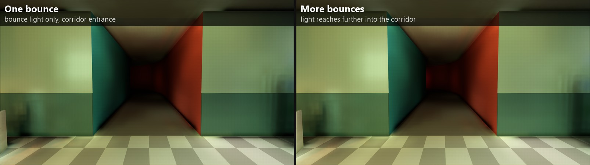
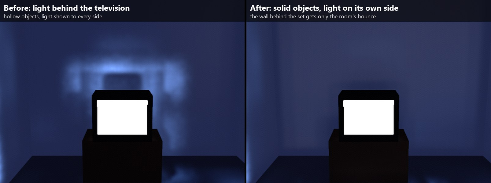

# Radiance Cascades Lab

A hands-on prototype of **Radiance Cascades** global illumination in **Godot 4.7**: real-time bounce light, written as
`CompositorEffect`s with compute shaders (GLSL through `RenderingDevice`). No engine changes and no plugins: open the folder in
Godot and run it.

The lab is one scene with several rooms, each built to test one thing: how light travels round a corner, what a moving object
does to its surroundings, how a television lights a dark room, how metal, glossy plastic and glass behave. A control panel
changes every setting live, a split view compares Godot alone with the effect, and a test harness measures cost, flicker and
artifacts.


## A tour of the scene

**The store.** 14 x 9.5 m, about 230 box props, six fluorescents, a sodium street lamp outside the windows, an optional sun, and
a dolly with a work lamp that rolls along the aisle (a moving object and a moving light). Props can be selected and dragged
with the mouse; the bounce light follows them.


**The curved corridor.** It leaves the store through the left wall and turns 90 degrees. There is no lamp inside: the light in
it comes from the store, bounce after bounce. The heat map view shows how far it gets.


At its far end a **neon sign** is the only light. It has no lamp: its glow reaches the walls and the ceiling through the bounce
alone.



**The materials room**, through a door in the corridor. One lamp, and on pedestals a chrome sphere, a gold sphere, a glossy red
plastic sphere and a rough plaster sphere, a copper box and a tinted glass pane. Metals get no diffuse bounce (they have no
diffuse colour) but reflect the room in their own colour; glass lets the light through.






**The dark room**, through the materials room. No lamp at all: a television on a stand, a sofa, a rug and a low table. The
screen's light reaches the room only through the bounce, and its picture slowly changes colour, so the light in the room
changes with it.





## How it works

| | Screen-space cascades | World-space cascades (the main one) |
|---|---|---|
| File | `src/rc/rc_effect.gd` | `src/rc/rc_world_effect.gd` |
| Scene data | the depth buffer and the lit colour | a voxelized copy of the scene (static once, moving objects every frame) |
| Off-screen light | invisible | counts |
| Probes | 2D, per pixel block | 3D grid, 4 cascades (0.35 m, 0.7 m, 1.4 m, 2.8 m apart at High) |

Per frame, the world-space version:

1. **lights the voxels**: the direct light of every lamp (with shadows), the light of glowing surfaces, and last frame's bounce
   light, so the light keeps bouncing;
2. **traces the probe cascades** from the coarsest to the finest, each merging into the one below (the far ones every other
   frame);
3. **traces short rays per pixel** for the first metres, so contact shadows and corners stay sharp, and reads a blurred
   reflection from the probes for shiny surfaces;
4. **gathers** per pixel with depth and normal weights, blends with the previous frame, filters across the surface and adds
   the result to the image.

Radiance Cascades were introduced by Alexander Sannikov (*Radiance Cascades: A Novel Approach to Calculating Global
Illumination*, 2023). Near a point, light needs fine spatial detail but few directions; far away it needs many directions but
little spatial detail. Each cascade covers one distance band with the trade-off that fits it, so the whole range costs about
the same per cascade.

### What it handles

| | |
|---|---|
| **Moving objects** | drawn as boxes into their own volume each frame: they cast soft bounce shadows and pick up colour |
| **Moving and changing lights** | the dolly's lamp, switches, the television's changing picture |
| **Glowing surfaces** | emissive materials light the scene with no lamp (static ones, and moving ones like the TV screen) |
| **More than one bounce** | last frame's probe light is fed back into the voxels; corridors and corners are no longer black |
| **Metals** | no diffuse bounce; a Fresnel-weighted reflection of the room in their own colour, turned by Godot's smooth normals |
| **Glossy plastic** | a 4 % reflection head-on, stronger at grazing angles |
| **Glass** | see-through materials are left out of the voxels, so light passes |
| **Solid objects, one-sided light** | closed meshes are filled inside, so no probe sits in the hollow of a box; a voxel shows its light only to rays coming from the side its surface faces, so nothing glows through or behind an object |





### Keeping it cheap and clean

- **Static geometry is voxelized on the GPU** straight from the meshes' vertex and index arrays, so a prop can be dragged and
  the scene voxelized again as it moves (about 2 ms of CPU per update here).
- **Only what changed is lit again**: around lights that changed and around moving objects, plus the whole volume every 4th
  frame for the extra bounces.
- **The far cascades are traced every other frame** and reused in between.
- **Jittered rays**, **clean object edges** and an **edge-aware filter** remove the grid lines, dashed silhouettes and fine noise
  the method leaves. The temporal blend ignores differences below a noise floor, so a still image does not shimmer.
- **Anti-aliasing**: Godot's TAA by default (off, FXAA, SMAA and MSAA 4x in the panel).


## Running it

You need **Godot 4.7** (the standard build is enough) and a GPU with Vulkan compute support.

```sh
godot --path . --rendering-driver vulkan
```

Or, with `GODOT` set to your Godot executable (or `godot` on the `PATH`): `.\scripts\run.bat` on Windows,
`./scripts/run.sh` on Linux / macOS.

### Controls

The lab starts in **cursor mode**, like an editor: the cursor is free for the panel and the props, and holding the right mouse
button looks around. The **quote key** (above Tab) switches to **look mode**, where the mouse turns the camera like in a game.
A coloured badge at the top of the screen always says which mode you are in, and the list of controls stays at the bottom
right (H hides it).

| Input | Action |
|---|---|
| **Quote key (above Tab)** | look mode on / off (Esc also leaves it) |
| Right mouse button (hold) | look around, in cursor mode |
| W A S D, Q / E | fly; down / up |
| Shift, mouse wheel | 3x faster; change the fly speed |
| Left click | select a prop (orange screen-space outline, move gizmo); hovering shows a yellow outline |
| Drag the prop / drag an arrow | move it over the floor / along that axis only |
| F, Esc | frame the selected prop; deselect |
| 1 / 2 / 3 / 4 / 5 | Godot only, + world bounce, bounce only, bounce heat map, + screen-space bounce |
| Space | pause the moving dolly |


The panel is split in tabs: **View** (view modes, split view), **GI** (every live setting of the effect,
image quality and performance switches), **Quality** (presets, volume sizes, anti-aliasing), **Scene** (lamps, the television,
glossy reflections, Godot's screen-space reflections), **Object** (the selected prop) and **Stats** (GPU time of every pass),
plus **Reset all**. **Split view** shows Godot alone on the left of a line and the effect on the right; drag the line.


## Test harness

Run with a flag after `--` and the lab writes images and numbers to `out/` (git-ignored), then quits:

| Flag | What it does |
|---|---|
| `--shots` | every place in the scene, with the effect off, on, bounce only and as a heat map |
| `--bench` | GPU time with the effect off and on, and per pass |
| `--pop` | frame-to-frame jumps at fixed floor points while the dolly moves past |
| `--artifacts` | close views with and without the image-quality fixes, camera still and moving |
| `--flicker` | 16 consecutive frames per configuration; `py tools/flicker_report.py` measures the shimmer |
| `--aatest` | the same views with each anti-aliasing mode |
| `--mattest` | the materials room (with debug views of the reflection and of the metal lookup) and the television at three moments |
| `--buildtest` | finds faces that would z-fight (same plane, same direction, overlapping) and overlapping walls, then photographs every joint (doors, corners, the bend) |
| `--uitest` | drives the control panel (views, object picker, split view, presets, reset, looking around) and checks the values |

Switches for A/B measurements: `--cpu-voxelize`, `--inject-full`, `--far-every=1`, `--no-jitter`, `--no-edge-fix`,
`--no-denoise`, `--still` (nothing moves), `--dense` (about 400,000 extra triangles), `--quality=default` (the cheaper preset)
`--hollow` (objects voxelized as shells), `--no-facing` (voxel light shown to every side) and `--aa=off|fxaa|smaa|taa|msaa`.

## Results on one machine

RX 9070 XT, 1920x1080, High preset (10 cm voxels, probes 0.35 m apart, 8 x 8 directions per pixel), TAA, the whole scene
(store, corridor, materials room, dark room), GPU time of the viewport:

| | ms (FPS) |
|---|---|
| Godot alone | 1.35 (740) |
| Godot + radiance cascades, nothing moving | 5.00 (200) |
| the same, volume frozen (no per-frame update) | 4.86 (206) |
| of which: cascades | 1.47 |
| near-field rays and reflections | 0.36 |
| final pass (gather, temporal, filter) | 1.99 |
| re-lighting the voxels | 0.13 (about 0.4-0.6 with the dolly and its lamp moving) |

These numbers come from a fast desktop GPU with other programs running; treat them as orders of magnitude.
`docs/DEVLOG.md` has every measurement behind every change, the ones that did not help included.

## Limits

- **One volume, fixed in place.** The voxel volume does not follow the camera, so large open worlds are out of scope.
- **Moving objects are boxes.** Characters, doors or anything that is not box-shaped would need a proper voxelizer.
- **Reflections are blurred.** They come from probes that hold 16 directions each: right for satin and brushed metal, far too
  soft for a mirror (Godot's own screen-space reflections, an option in the panel, give sharp on-screen ones).
- **Glass is simply see-through** for the bounce light: no tint, no refraction.
- **Up to 16 lights per frame**, and a soft, slightly blurry result in tight corners.
- The screen-space version cannot see anything off screen, by construction.

## Repository layout

```
project.godot, main.tscn   Godot project (main.tscn runs src/main.gd)
src/main.gd                camera, controls, interactive mode and the test harness
src/shop_scene.gd          the scene: rooms and openings painted on a 5 cm grid, the corridor's bend, box props (KIT)
src/ui_panel.gd            the control panel
src/object_picker.gd       hover, select and move props (outlines, move gizmo)
src/outline.gdshader       the screen-space selection outline
src/rc/rc_effect.gd        screen-space radiance cascades
src/rc/rc_world_effect.gd  world-space radiance cascades
src/rc/shaders/            compute shaders (.comp) and their includes (.inc)
scripts/                   launchers for Windows and Linux / macOS
tools/flicker_report.py    measures the shimmer in the frames --flicker writes
docs/DEVLOG.md             every step in order: what broke, how it was measured and fixed
docs/images/               the images the devlog refers to
docs/readme/               the images of this page
```

## License

MIT, see [LICENSE](LICENSE).
