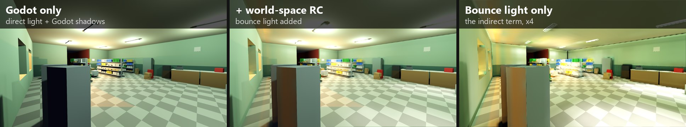
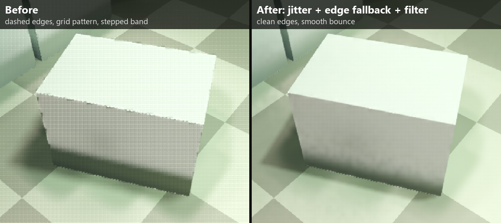
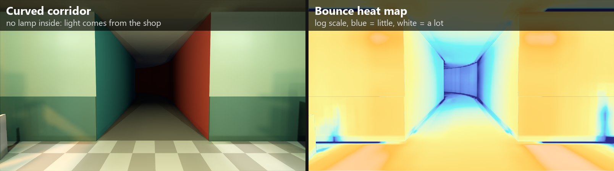
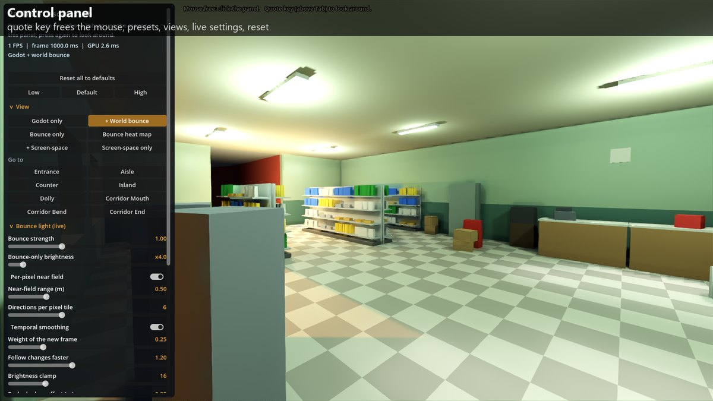
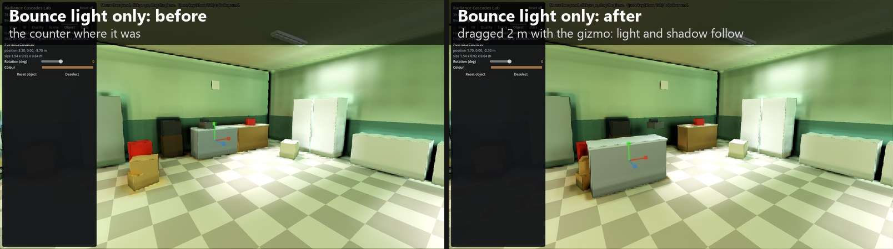
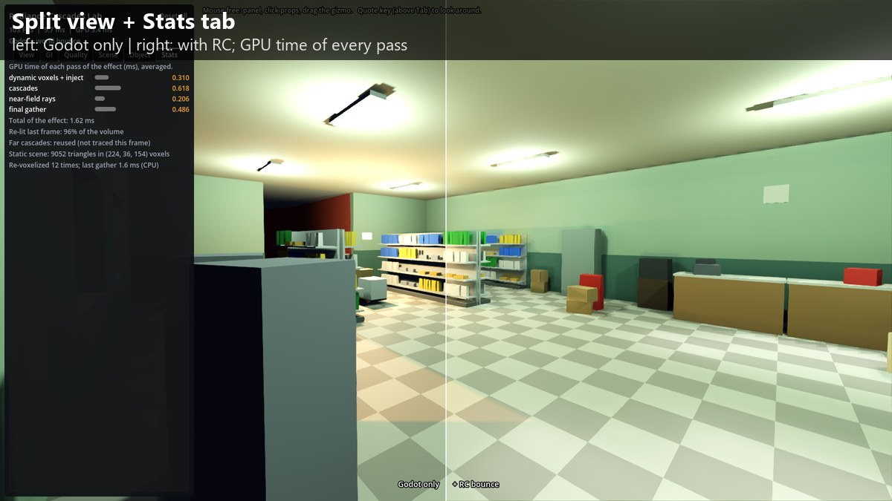

# Radiance Cascades Lab

A hands-on prototype of **Radiance Cascades** global illumination in **Godot 4.7**, written as `CompositorEffect`s with
compute shaders (GLSL through `RenderingDevice`). No engine changes and no plugins: open the folder in Godot and run it.

The goal is to see how the method behaves in practice: how light travels around corners, how it reacts to moving objects
and lights, what artifacts it produces and what it costs per frame.



## What is in here

| | Screen-space cascades | World-space cascades |
|---|---|---|
| File | `src/rc/rc_effect.gd` | `src/rc/rc_world_effect.gd` |
| Scene data | the depth buffer and the lit colour | a voxelized copy of the scene (static once, moving objects every frame) |
| Off-screen light | invisible | counts |
| Probes | 2D, per pixel block | 3D grid, 4 cascades (0.5 m, 1 m, 2 m, 4 m apart) |

The world-space version is the main one. Per frame it:

1. injects the direct light of every light (with shadows) into the surface voxels;
2. traces the probe cascades from the coarsest to the finest, each one merging into the one below;
3. adds short per-pixel rays for the near field (the first 0.5 m), so contact shadows and corners stay sharp;
4. gathers the probes per pixel, with depth and normal weights, and blends with the previous frame (reprojected).

Moving objects are drawn as boxes into their own volume each frame, and lights can move, change colour or flicker.

Three things keep the per-frame cost down:

- **Static geometry is voxelized on the GPU** straight from the meshes' vertex and index arrays, so a prop can be moved and the
  scene voxelized again while it is dragged.
- **Only what changed is lit again**: the direct light is injected only around lights that changed and around moving objects.
  When nothing moves, that pass costs nothing.
- **The far cascades are traced every other frame** and reused in between: far light changes slowly.

Three more keep the image clean (each can be switched off in the GI tab):

- **Jittered rays**: each pixel starts its rays at a random point every frame, so the straight lines of the voxel and probe
  grids turn into noise that the temporal blend averages away; occupancy fades in over the first 1.5 voxels of a ray, so a
  surface that is not aligned with the grid does not shadow itself with its own voxel staircase.
- **Clean object edges**: where an object's edge rejects most of a pixel's neighbours, the rays are gathered from a window
  twice as wide, so no dashed line runs along silhouettes.
- **Edge-aware filter**: the bounce light is averaged over 7 x 7 pixels of the same surface, which removes the fine grid the
  per-pixel directions leave.



## The scene

One scene holds everything: a 14 x 9.5 m store with ~230 box props, six fluorescents (one flickers), a sodium street lamp
outside the windows, an optional sun, a dolly with a work lamp that rolls along the aisle, and a curved corridor off the store
with no lamp of its own, to see how far light travels round a bend.



## Running it

You need **Godot 4.7** (the standard build is enough) and a GPU with Vulkan compute support.

```sh
godot --path . --rendering-driver vulkan
```

Or, with `GODOT` set to your Godot executable (or `godot` on the `PATH`): `.\scripts\run.bat` on Windows,
`./scripts/run.sh` on Linux / macOS.

### Controls

The lab starts in **cursor mode**, like an editor: the cursor is free for the panel and the props, and holding the right mouse
button looks around. The **quote key** (above Tab) switches to **look mode**, where the mouse turns the camera like in a game.
A coloured badge at the top of the screen always says which mode you are in, and the list of controls stays at the bottom right
(H hides it).

| Input | Action |
|---|---|
| **Quote key (above Tab)** | look mode on / off (Esc also leaves it) |
| Right mouse button (hold) | look around, in cursor mode |
| W A S D, Q / E | fly; down / up |
| Shift, mouse wheel | 3x faster; change the fly speed |
| Left click | select a prop (orange screen-space outline, move gizmo); hovering shows a yellow outline |
| Drag the prop / drag an arrow | move it over the floor / along that axis only |
| F, Esc | frame the selected prop; deselect |
| 1 / 2 / 3 / 4 / 5 | Godot only, + world bounce, bounce only, bounce heat map, + screen-space bounce |
| Space | pause the moving dolly (Z / X move it by hand when "Dolly rolls" is off) |



The panel is split in tabs: **View** (view modes, split view, places to jump to), **GI** (every live setting of the effect and
the performance switches), **Quality** (presets and volume sizes), **Scene** (the lights), **Object** (the selected prop) and
**Stats** (GPU time of every pass), plus **Reset all**.

While a prop moves, the bounce light follows it: the scene is voxelized again on the GPU as it is dragged.



**Split view** shows Godot alone on the left of a line and the effect on the right; drag the line.



## Test harness

Run with a flag after `--` and the lab writes images and numbers to `out/` (git-ignored), then quits:

| Flag | What it does |
|---|---|
| `--shots` | fixed camera poses, each with the effect off, on, indirect only and as a heat map |
| `--bench` | GPU time with the effect off and on, and per pass |
| `--pop` | frame-to-frame jumps at fixed floor points while the dolly moves past (flicker) |
| `--artifacts` | close views with and without the image-quality fixes, camera still and moving |
| `--uitest` | drives the control panel (views, object picker, split view, presets, reset) and checks the values come back |

Switches for A/B measurements: `--cpu-voxelize` (pack the triangles on the CPU, as before), `--inject-full` (light the whole
volume every frame), `--far-every=1` (trace every cascade every frame), `--no-jitter`, `--no-edge-fix`, `--no-denoise` (the image-quality fixes), `--still` (nothing moves, no light changes) and
`--dense` (about 400,000 extra triangles).

## Results on one machine

RX 9070 XT, 1920x1080, everything dynamic (voxels of moving objects and lights redone every frame):

| | ms |
|---|---|
| Store, Godot alone | 1.70 |
| Store, Godot + world-space cascades | 2.92 |
| of which: moving voxels + light injection | 0.06 |
| cascades | 0.40 |
| near-field rays | 0.33 |
| final gather + temporal | 0.60 |

Flicker around the moving dolly, as the mean / max frame-to-frame jump at 20 floor points (x1000, signal about 780):
0.70 / 7.5 with temporal smoothing, 3.4 / 30 without.

What the three optimizations saved (same machine, 1920x1080, shop, `--bench`; old = `--cpu-voxelize --inject-full --far-every=1`):

| | old | new |
|---|---|---|
| Nothing moving: re-lighting the volume | 0.282 ms | 0.005 ms |
| Nothing moving: cascades | 0.659 ms | 0.527 ms |
| Nothing moving: whole frame | 2.86 ms (350 FPS) | 2.47 ms (406 FPS) |
| Dolly rolling and a light flickering: re-lighting | 0.294 ms | 0.332 ms (they touch almost the whole store) |
| Dolly rolling: cascades | 0.738 ms | 0.673 ms |
| 431,000 triangles: gathering the scene at start-up | 234 ms | 103 ms |
| Gathering it again while a prop is dragged | | 1.7 ms |

The image-quality fixes cost time in the final pass (same machine, nothing moving): 0.72 ms without them, 1.63 ms with all three
(clean edges about 0.5 ms, the filter about 0.4 ms, jitter nothing measurable); whole frame 2.69 ms (372 FPS) -> 3.62 ms (277 FPS).

These numbers come from a fast desktop GPU with other programs running; treat them as orders of magnitude.

## Limits

- **One volume, fixed in place.** The voxel volume does not follow the camera, so large open worlds are out of scope.
- **Moving objects are boxes.** Characters, doors or anything that is not box-shaped would need a proper voxelizer.
- **Moving a static prop re-voxelizes the whole scene** (cheap here, ~2 ms of CPU, but it grows with the scene).
- **One bounce**, a soft and slightly blurry result in tight corners, and up to 16 lights per frame.
- The screen-space version cannot see anything off screen, by construction.

## Repository layout

```
project.godot, main.tscn   Godot project (main.tscn runs src/main.gd)
src/main.gd                camera, controls, interactive mode and the test harness
src/shop_scene.gd          the store and the curved corridor (box props in KIT)
src/ui_panel.gd            the control panel
src/object_picker.gd       hover, select and move props (outlines, move gizmo)
src/rc/rc_effect.gd        screen-space radiance cascades
src/rc/rc_world_effect.gd  world-space radiance cascades
src/rc/shaders/            compute shaders (.comp) and their includes (.inc)
scripts/                   launchers for Windows and Linux / macOS
docs/DEVLOG.md             every step in order: what broke, how it was measured and fixed
docs/images/               the images the devlog refers to
docs/readme/               the images of this page
```

## Background

Radiance Cascades were introduced by Alexander Sannikov (*Radiance Cascades: A Novel Approach to Calculating Global
Illumination*, 2023). The idea: near a point, light needs fine spatial detail but few directions; far away it needs many
directions but little spatial detail. Each cascade covers one distance band with the trade-off that fits it, so the
whole range costs about the same per cascade.

`docs/DEVLOG.md` tells how this prototype got from a first noisy version to the current one, with the measurements behind
every change.

## License

MIT, see [LICENSE](LICENSE).
