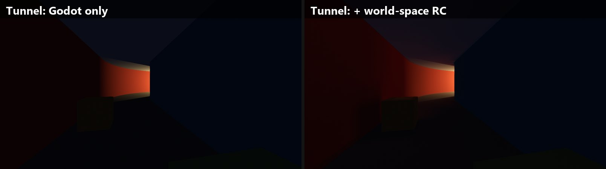

# Radiance Cascades Lab

A hands-on prototype of **Radiance Cascades** global illumination in **Godot 4.7**, written as `CompositorEffect`s with
compute shaders (GLSL through `RenderingDevice`). No engine changes and no plugins: open the folder in Godot and run it.

The goal is to see how the method behaves in practice: how light travels around corners, how it reacts to moving objects
and lights, what artifacts it produces and what it costs per frame.


## What is in here

| | Screen-space cascades | World-space cascades |
|---|---|---|
| File | `src/rc/rc_effect.gd` | `src/rc/rc_world_effect.gd` |
| Scene data | the depth buffer and the lit colour | a voxelized copy of the scene (static once, moving objects every frame) |
| Off-screen light | invisible | counts |
| Probes | 2D, per pixel block | 3D grid, 4 cascades (0.5 m, 1 m, 2 m, 4 m apart) |

The world-space version is the main one. Per frame it:

1. injects the direct light of every light (with shadows) into the surface voxels;
2. traces the probe cascades from the coarsest to the finest, each one merging into the one below;
3. adds short per-pixel rays for the near field (the first 0.5 m), so contact shadows and corners stay sharp;
4. gathers the probes per pixel, with depth and normal weights, and blends with the previous frame (reprojected).

Moving objects are drawn as boxes into their own volume each frame, and lights can move, change colour or flicker.

## Scenes

| Scene | What it tests |
|---|---|
| `tunnel` (default) | a curved tunnel with a lamp that moves along it and a moving cart: light travelling round a bend |
| `shop` | a 14 x 9.5 m store with ~230 box props, six fluorescents (one flickers), a street lamp, a rolling dolly with a work lamp, a curved corridor with no lamp of its own, and the control panel |
| `street` | a street at night with lamp posts: what happens when the lamp leaves the screen |
| `room` | a trivial room, for the screen-space version |




## Running it

You need **Godot 4.7** (the standard build is enough) and a GPU with Vulkan compute support.

```sh
godot --path . --rendering-driver vulkan -- --scene=shop
```

Or, with `GODOT` set to your Godot executable (or `godot` on the `PATH`):

| | |
|---|---|
| Windows | `.\scripts\run_shop.bat` (shop with the control panel), `.\scripts\run.bat --scene=tunnel` |
| Linux / macOS | `./scripts/run.sh --scene=shop` |

### Controls

| Key | Action |
|---|---|
| Quote key (above Tab) | free the mouse to use the control panel; press again to look around |
| Mouse, WASD, Q / E, Shift | look, move, down / up, faster |
| 1 / 2 / 3 / 4 / 5 | Godot only, + world bounce, bounce only, bounce heat map, + screen-space bounce |
| G / T | per-pixel near field on/off, temporal smoothing on/off |
| Space | pause the moving objects (Z / X move the dolly by hand when "Dolly rolls" is off in the panel) |


The panel has quality presets (Low, Default, High), every live setting of the effect, the lights of the scene, and
**Reset all to defaults**.

## Test harness

Run with a flag after `--` and the lab writes images and numbers to `out/` (git-ignored), then quits:

| Flag | Scene | What it does |
|---|---|---|
| `--shots` | all | fixed camera poses, each with the effect off, on, and indirect only |
| `--bench` | all | GPU time with the effect off and on, and per pass |
| `--travel` | tunnel | how far the bounce reaches round the bend, and how fast it follows a moving lamp |
| `--pop` | tunnel, shop | frame-to-frame jumps at fixed floor points while an object moves past (flicker) |
| `--lag` | tunnel | how far the temporal blend trails behind a moving shadow |
| `--leak` | tunnel | light on the outer face of a wall that should be dark |
| `--motionmaps` | tunnel | difference images of two frames a few centimetres apart |
| `--uitest` | shop | drives the control panel (views, presets, reset) and checks the values come back |

## Results on one machine

RX 9070 XT, 1920x1080, everything dynamic (voxels of moving objects and lights redone every frame):

| | ms |
|---|---|
| Store, Godot alone | 1.70 |
| Store, Godot + world-space cascades | 2.92 |
| of which: moving voxels + light injection | 0.06 |
| cascades | 0.40 |
| near-field rays | 0.33 |
| final gather + temporal | 0.60 |

Flicker around a moving object, as the mean / max frame-to-frame jump at 20 floor points (x1000, signal about 780):
0.70 / 7.5 with temporal smoothing, 3.4 / 30 without. Light through a wall on the far side: 0.0.

These numbers come from a fast desktop GPU with other programs running; treat them as orders of magnitude.

## Limits

- **One volume, fixed in place.** The voxel volume does not follow the camera, so large open worlds are out of scope.
- **Moving objects are boxes.** Characters, doors or anything that is not box-shaped would need a proper voxelizer.
- **Static geometry is voxelized once at start-up**, on the CPU in GDScript (a few seconds for ~250k triangles).
- **One bounce**, a soft and slightly blurry result in tight corners, and up to 16 lights per frame.
- The screen-space version cannot see anything off screen, by construction.

## Repository layout

```
project.godot, main.tscn   Godot project (main.tscn runs src/main.gd)
src/main.gd                scenes, camera, interactive mode and the test harness
src/shop_scene.gd          the store and the curved corridor (box props in KIT)
src/ui_panel.gd            the control panel
src/rc/rc_effect.gd        screen-space radiance cascades
src/rc/rc_world_effect.gd  world-space radiance cascades
src/rc/shaders/            compute shaders (.comp) and their includes (.inc)
scripts/                   launchers for Windows and Linux / macOS
docs/DEVLOG.md             every step in order: what broke, how it was measured and fixed
docs/images/               the images the devlog refers to
docs/readme/               the images of this page
```

## Background

Radiance Cascades were introduced by Alexander Sannikov (*Radiance Cascades: A Novel Approach to Calculating Global
Illumination*, 2023). The idea: near a point, light needs fine spatial detail but few directions; far away it needs many
directions but little spatial detail. Each cascade covers one distance band with the trade-off that fits it, so the
whole range costs about the same per cascade.

`docs/DEVLOG.md` tells how this prototype got from a first noisy version to the current one, with the measurements behind
every change.
