# Radiance Cascades Lab

Real-time bounce light with **Radiance Cascades** in **Godot 4.7**, written as a `CompositorEffect` with compute shaders.
No engine changes, no plugins: open the folder in Godot and run it.

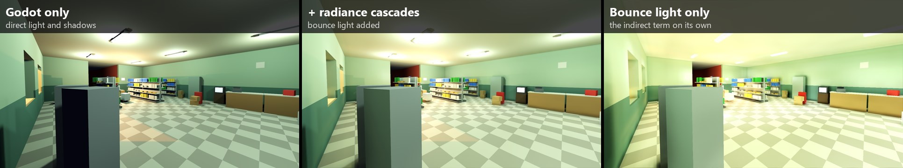

## The scene

A store, a curved corridor with no lamp inside, a room of materials and a dark room lit only by a television.

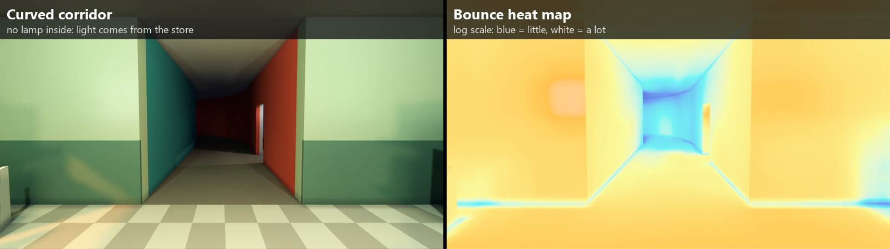

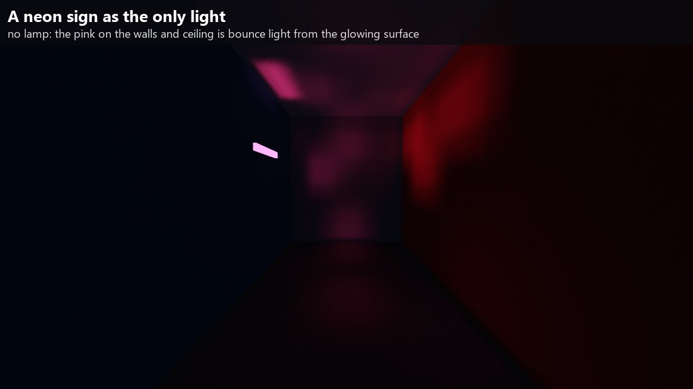

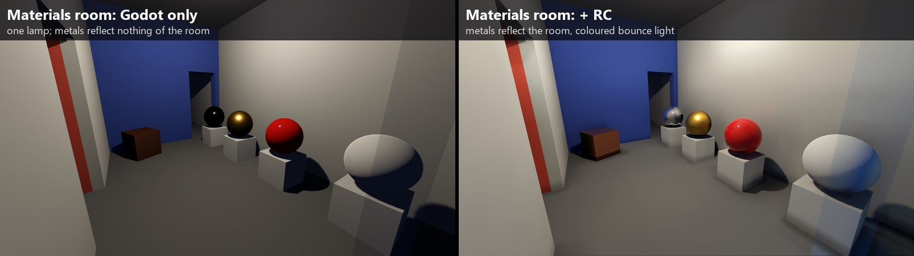

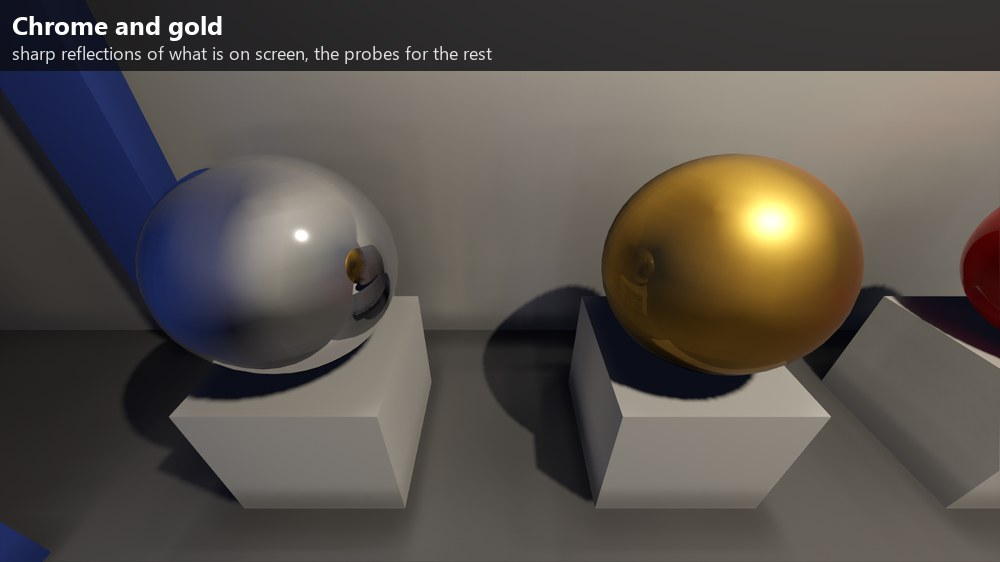

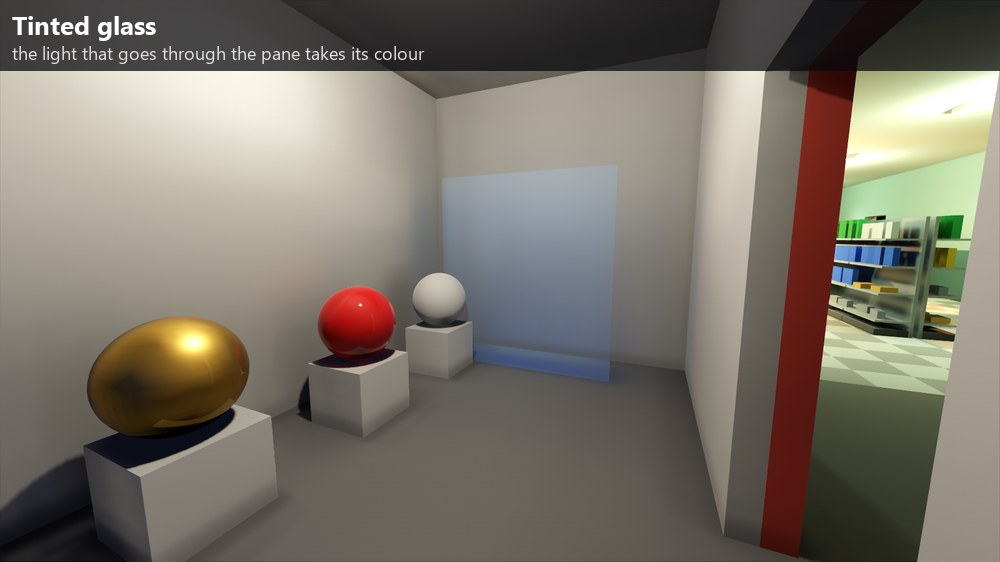

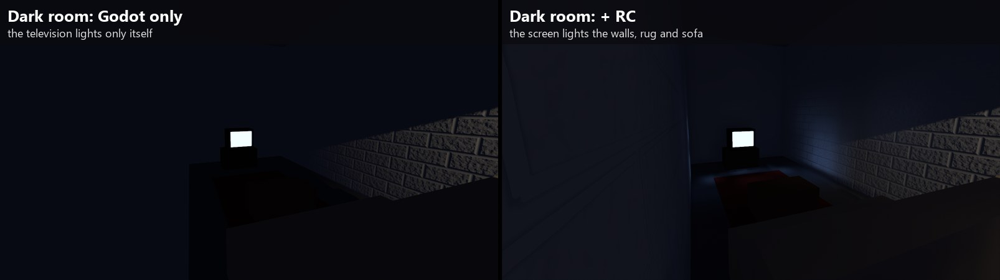

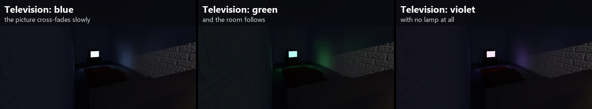

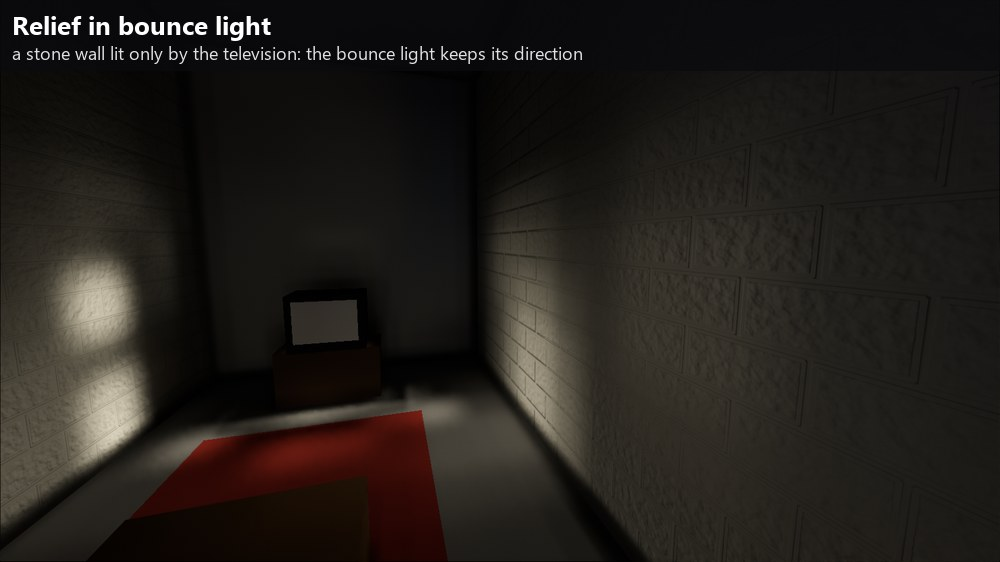

## The city

`--city` builds a night city procedurally: blocks of shops and flats, a plaza, a market, a park, wet streets, lamps, trees,
parked cars, traffic lights, bus stops and neon signs, and traffic: cars with spot-light headlights driving round the blocks. The GI volume is much smaller
than the city and follows the camera.

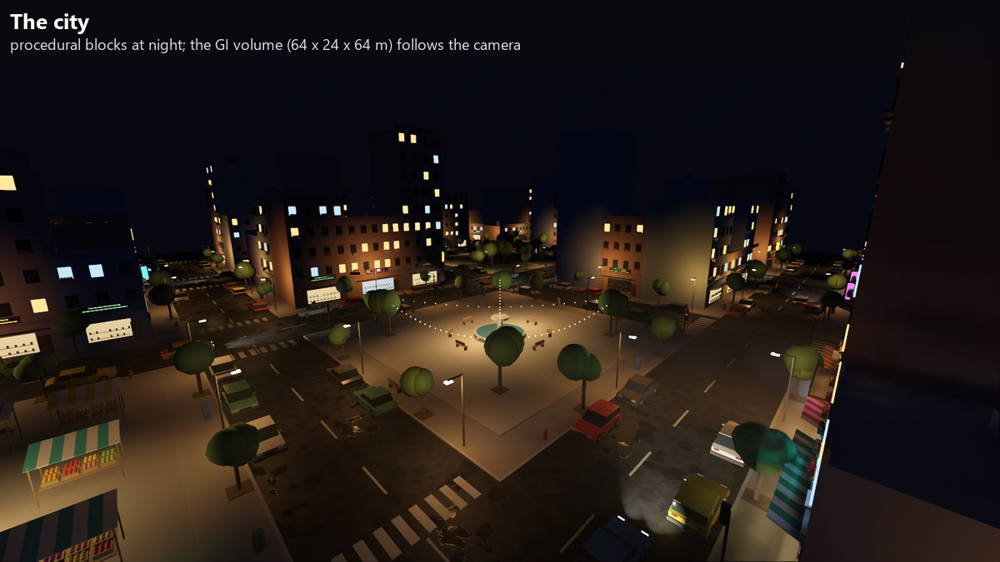

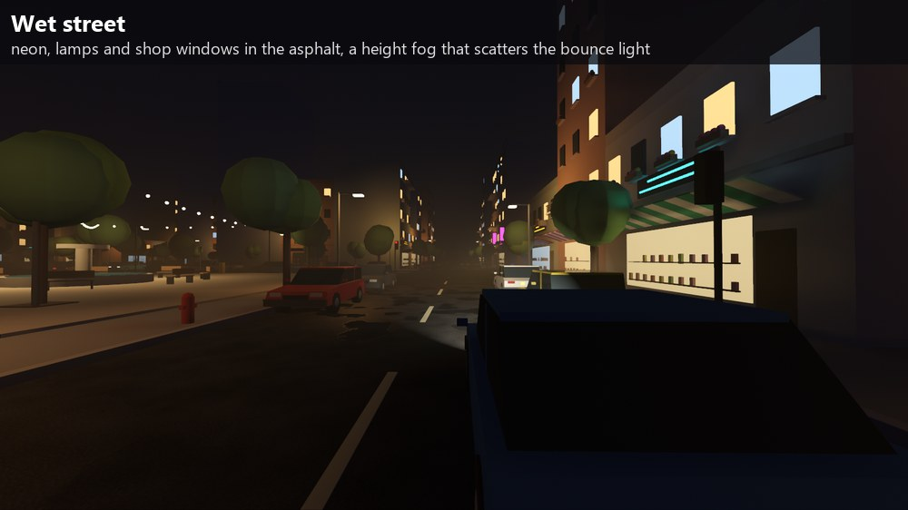

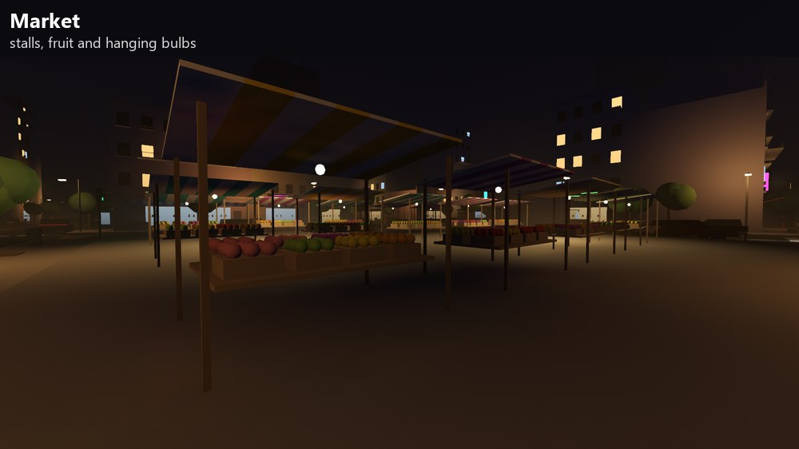

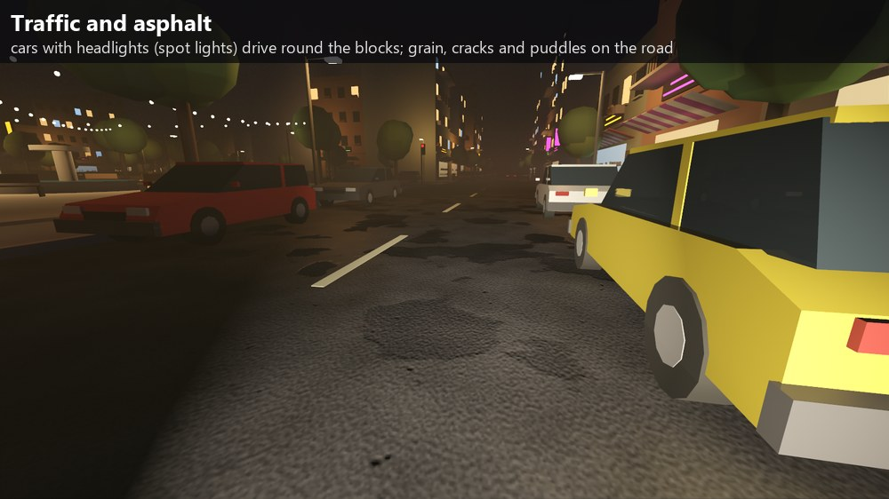

## How it works

The scene is voxelized, and every frame the effect:

1. lights the voxels (lamps with shadows, glowing surfaces, last frame's bounce);
2. traces the probe cascades, coarsest to finest, each merging into the one below;
3. traces short rays per pixel for sharp contact shadows, and reflections for shiny surfaces (sharp from the picture where it can, blurred from the probes elsewhere);
4. gathers per pixel, blends with the previous frame and filters.

It handles moving objects and lights (omni, spot, sun), emissive surfaces, several bounces, normal maps in bounce light,
metals, glossy plastic, tinted glass, a sky with a horizon and a fog that scatters the bounce light.

Radiance Cascades: Alexander Sannikov, *Radiance Cascades: A Novel Approach to Calculating Global Illumination* (2023).

## Running it

Godot 4.7 and a GPU with Vulkan compute support:

```sh
godot --path . --rendering-driver vulkan
godot --path . --rendering-driver vulkan -- --city
```

| Input | Action |
|---|---|
| Right mouse button (hold) | look around |
| Quote key (above Tab) | look mode on / off |
| W A S D, Q / E | fly; down / up |
| Left click, drag | select and move a prop |
| 1 to 5 | Godot only, + bounce, bounce only, heat map, screen-space |

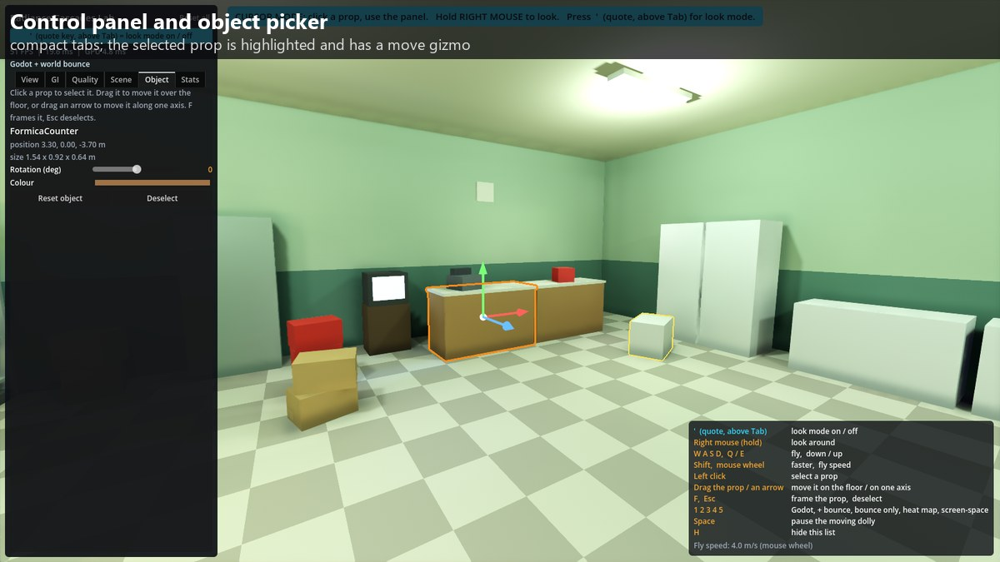

## Performance

RX 9070 XT, 1920x1080, nothing moving:

| | Godot + radiance cascades, ms (FPS) |
|---|---|
| Rooms, High (10 cm voxels) | 4.61 (217) |
| Rooms, Low (25 cm voxels) | 2.85 (351) |
| City, default (25 cm voxels, 64 x 24 x 64 m) | 6.67 (150) |
| the same, with the traffic moving | 7.18 (139) |
| City, High (20 cm voxels) | 9.56 (105) |
| City, Low (40 cm voxels) | 3.26 (307) |

When the volume follows the camera into new ground, that frame takes about 12 ms.

## Limits

- One voxel volume: it follows the camera, but what is outside it gets no bounce light, and moving it costs one slow frame.
- Moving objects are voxelized as boxes.
- Sharp reflections only show what is on screen; the rest is blurred.

Every step, with its measurements, is in [docs/DEVLOG.md](docs/DEVLOG.md).

## License

MIT, see [LICENSE](LICENSE).
